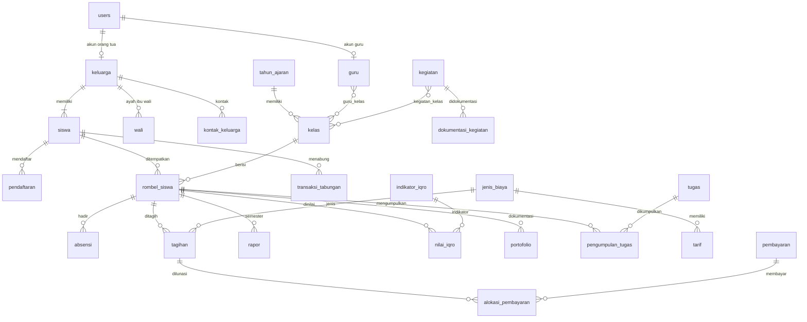
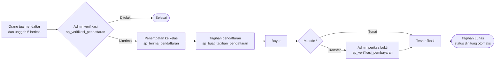

<div align="center">

# 🌙 SINAR

### Sistem Informasi Najmah Rugayah Darus

**Sistem informasi berbasis web untuk mengelola data siswa dan administrasi TK Najmah Rugayah Darus, Medan.**


*Satu sistem untuk absensi, SPP, tabungan, pembelajaran, rapor, dan dokumentasi kegiatan.*

[Latar Belakang](#-latar-belakang) · [Fitur](#-fitur-per-pengguna) · [Database](#-perancangan-database) · [Instalasi](#-instalasi) · [Tim](#-tim-kelompok-6)

</div>

---

## 📑 Daftar Isi

1. [Tentang Proyek](#-tentang-proyek)
2. [Latar Belakang](#-latar-belakang)
3. [Tujuan](#-tujuan)
4. [Fitur per Pengguna](#-fitur-per-pengguna)
5. [Aturan Bisnis dari Mitra](#-aturan-bisnis-dari-mitra)
6. [Teknologi](#-teknologi)
7. [Perancangan Database](#-perancangan-database)
8. [Objek Database](#-objek-database)
9. [Transaksi dan Keamanan](#-transaksi-dan-keamanan)
10. [Alur Utama Sistem](#-alur-utama-sistem)
11. [Metodologi Pengembangan](#-metodologi-pengembangan)
12. [Instalasi](#-instalasi)
13. [Struktur Folder](#-struktur-folder)
14. [Batasan Sistem](#-batasan-sistem)
15. [Tim Kelompok 6](#-tim-kelompok-6)

---

## 🏫 Tentang Proyek

| | |
|---|---|
| **Nama sistem** | SINAR (Sistem Informasi Najmah Rugayah Darus) |
| **Mitra** | TK Najmah Rugayah Darus, Medan |
| **Mata kuliah** | Manajemen Sistem Basis Data (MSBD) |
| **Program studi** | Teknologi Informasi, Fakultas Ilmu Komputer dan Teknologi Informasi |
| **Perguruan tinggi** | Universitas Sumatera Utara |
| **Dosen pengampu** | Bapak Dedy Arisandi, S.T., M.Kom. |
| **Kelompok** | Kelompok 6, Kom A |
| **Jenis tugas** | Tugas besar: analisis kebutuhan, perancangan basis data, implementasi, dan pengujian |

---

## 📖 Latar Belakang

Pengelolaan administrasi di TK Najmah Rugayah Darus sebelumnya dilakukan lewat media yang terpisah: Microsoft Excel, catatan tulis tangan, kartu SPP, dan buku tabungan. Akibatnya data tidak terpusat dan sulit diperbarui, dicari, maupun direkap.

Data lama yang kami terima juga memperlihatkan dampaknya secara nyata. Ada **213 baris data siswa yang ternyata hanya 133 anak**, karena data orang tua yang tercatat ganda membuat anak yang sama muncul berkali-kali. Ejaan tempat lahir, pekerjaan, dan pendidikan juga tidak seragam, dan nomor HP lebih dari satu sering tertulis dalam satu kolom. SINAR dirancang untuk mengakhiri masalah-masalah itu dari akar basis datanya.

## 🎯 Tujuan

- Merancang dan mengimplementasikan basis data terpusat yang **bebas redundansi dan konsisten** (dinormalisasi hingga 3NF).
- Mengintegrasikan pengelolaan data siswa dan administrasi sekolah dalam satu aplikasi web.
- Memberi hak akses yang sesuai peran untuk empat jenis pengguna.
- Mengurangi ketergantungan pada pencatatan yang tersebar, dan mendukung informasi akademik siswa yang lebih terstruktur.

---

## 👥 Fitur per Pengguna

SINAR melayani empat jenis pengguna (kolom `users.role`: `admin`, `kepala_sekolah`, `guru`, `orang_tua`).

<table>
<tr>
<td width="25%" valign="top">

### 🛠️ Administrator TK
- Kelola data siswa, keluarga, wali, guru, kelas, dan tahun ajaran
- Verifikasi pendaftaran dan berkas
- Atur tarif dan terbitkan tagihan
- Catat pembayaran tunai, verifikasi bukti transfer
- Catat tabungan siswa
- Kelola akun pengguna

</td>
<td width="25%" valign="top">

### 🧑‍💼 Kepala Sekolah
- Dashboard ringkasan sekolah
- Pantau kehadiran, tunggakan, dan keuangan
- Pantau kesiapan dan kualitas data
- Lihat laporan kegiatan

</td>
<td width="25%" valign="top">

### 👩‍🏫 Guru
- Absensi kelas yang diampu
- Rencana pembelajaran harian
- Beri dan nilai tugas
- Susun rapor, nilai IQRO, dan portofolio siswa
- Unggah dokumentasi kegiatan

</td>
<td width="25%" valign="top">

### 👨‍👩‍👧 Orang Tua
- Daftarkan anak dan unggah berkas
- Lihat kehadiran, tagihan, tabungan, tugas, dan rapor anak
- Unggah bukti transfer
- Kumpulkan tugas
- Lihat foto kegiatan

</td>
</tr>
</table>

Orang tua hanya dapat melihat anaknya sendiri, dan guru hanya kelas yang diampu. Pembatasan ini dijaga oleh Policy Laravel dan dilapisi aturan di tingkat database.

### Modul Utama

| Modul | Cakupan |
|---|---|
| 📝 Pendaftaran siswa baru | Formulir, lima berkas wajib, verifikasi, penempatan ke kelas |
| 🧒 Data siswa dan keluarga | Siswa, ayah, ibu, wali, kontak, alamat |
| 🗓️ Absensi | Hadir, izin, sakit, alfa; rekap bulanan dan persen kehadiran |
| 💰 SPP dan biaya | Tarif per kelompok, tagihan, pembayaran, tunggakan, kuitansi |
| 🐷 Tabungan | Setor dan tarik dengan saldo yang selalu dihitung dari riwayat |
| 📚 Pembelajaran | Rencana pembelajaran, tugas, pengumpulan, dan penilaian |
| 🧾 Rapor | Narasi per aspek, pertumbuhan anak, nilai IQRO, refleksi orang tua |
| 📸 Kegiatan | Kegiatan, field trip, dan dokumentasi foto sebelum, selama, dan sesudah |

---

## 📌 Aturan Bisnis dari Mitra

Aturan berikut kami dapat langsung dari pihak sekolah dan sudah tertanam di basis data.

| Hal | Aturan |
|---|---|
| **SPP bulanan** | KB (PG) **Rp250.000**; TK A dan TK B **Rp350.000** |
| **Uang pendaftaran** | Hanya saat awal masuk: administrasi, pembangunan, baju, buku dan perlengkapan, outbond |
| **Naik kelompok** | KB ke TK A atau TK A ke TK B tidak ditagih ulang, karena sudah dihitung dari uang pendaftaran awal |
| **Field trip** | Biaya kegiatan dibayar saat akan berangkat |
| **Berkas pendaftaran** | Formulir, akta kelahiran anak, kartu keluarga (KK), KTP ayah, KTP ibu |
| **Metode bayar** | Tunai atau transfer dengan verifikasi manual oleh admin |
| **Kelompok** | KB, TK A, TK B |

---

## 🧰 Teknologi

| Lapisan | Teknologi |
|---|---|
| Framework | Laravel (PHP 8.2) |
| Basis data | MySQL 8.0 (tervalidasi pada 8.0.30), engine InnoDB, charset `utf8mb4` |
| Alat bantu DB | phpMyAdmin |
| Antarmuka | Blade dan Tailwind CSS <!-- sesuaikan bila berbeda --> |
| Autentikasi | Laravel Auth dengan hak akses berbasis peran |

---

## 🗄️ Perancangan Database

Basis data **`db_tk_final`** terdiri dari **30 tabel**, **22 view**, **14 function**, **17 stored procedure**, dan **34 trigger**.

| Objek | Jumlah |
|---|---:|
| Tabel | 30 |
| View | 22 |
| Stored function | 14 |
| Stored procedure | 17 |
| Trigger | 34 |

### ERD



> **Kunci rancangan:** `rombel_siswa` (penempatan siswa di kelas) menjadi pusat relasi. Absensi, tagihan, rapor, nilai IQRO, portofolio, dan pengumpulan tugas semuanya menunjuk ke rombel, sehingga siswa dan kelasnya selalu konsisten.

### Daftar 30 Tabel

| Kelompok | Tabel |
|---|---|
| Pengguna dan keluarga | `users`, `keluarga`, `kontak_keluarga`, `wali`, `siswa` |
| Guru dan akademik | `guru`, `tahun_ajaran`, `kelas`, `guru_kelas`, `rombel_siswa`, `absensi` |
| Pendaftaran | `pendaftaran`, `dokumen_pendaftaran` |
| Keuangan | `jenis_biaya`, `tarif`, `tagihan`, `pembayaran`, `alokasi_pembayaran`, `transaksi_tabungan` |
| Pembelajaran dan penilaian | `rencana_pembelajaran`, `tugas`, `pengumpulan_tugas`, `rapor`, `indikator_iqro`, `nilai_iqro`, `portofolio` |
| Kegiatan | `kegiatan`, `kegiatan_kelas`, `dokumentasi_kegiatan` |
| Sistem | `audit_log` |

### Normalisasi (1NF sampai 3NF)

Contoh yang dinormalisasi adalah formulir pendaftaran siswa baru.

| Tahap | Masalah | Pemecahan |
|---|---|---|
| **UNF** | Nomor HP dan berkas berulang dalam satu baris; data orang tua dicatat ulang untuk tiap anak | |
| **1NF** | Kolom tidak atomik, ada kelompok berulang | `kontak_keluarga` (satu nomor satu baris), `dokumen_pendaftaran` (satu berkas satu baris), ayah dan ibu menjadi baris `wali`; nama dan gelar dipisah |
| **2NF** | Atribut hanya bergantung pada sebagian kunci | `siswa`, `kelas`, dan `rombel_siswa` dipisah; `pembayaran` dipisah dari `alokasi_pembayaran` |
| **3NF** | Ketergantungan transitif | `keluarga` memegang No. KK dan alamat; tarif hanya di `tarif`; saldo tabungan dan status tagihan **tidak disimpan** tetapi dihitung |

**Dari 213 baris menjadi 133 anak:** orang tua yang duplikat dipersatukan menjadi satu keluarga, sehingga satu anak hanya tercatat satu kali.

### Data Awal yang Sudah Terisi

| Data | Jumlah |
|---|---:|
| Siswa | 133 |
| Keluarga | 126 |
| Wali (ayah, ibu, wali) | 186 |
| Kontak keluarga | 97 |
| Guru | 8 |
| Kelas | 18 |
| Penempatan siswa (rombel) | 191 |
| Tahun ajaran | 3 (aktif: 2026-2027) |
| Indikator IQRO | 74 |
| Jenis biaya | 7 |
| Tarif SPP | 3 (KB, TK A, TK B) |

---

## ⚙️ Objek Database

### Stored Function (14)

| Function | Fungsi |
|---|---|
| `fn_saldo_tabungan` | Saldo tabungan siswa dari riwayat setor dan tarik |
| `fn_dibayar_tagihan`, `fn_sisa_tagihan`, `fn_status_tagihan` | Jumlah dibayar, sisa, dan status tagihan |
| `fn_total_tunggakan_siswa`, `fn_total_tunggakan_keluarga` | Total tunggakan per anak dan per keluarga |
| `fn_no_kuitansi`, `fn_no_pendaftaran` | Penomoran dokumen yang dihitung, bukan disimpan |
| `fn_persen_kehadiran` | Persentase kehadiran siswa pada rentang tanggal |
| `fn_semester`, `fn_awal_semester`, `fn_akhir_semester` | Penentuan Ganjil atau Genap dan batas tanggalnya |
| `fn_hitung_usia` | Usia anak dalam teks |
| `fn_title_case` | Penyeragaman huruf nama |

### Stored Procedure (17)

| Kelompok | Procedure |
|---|---|
| Pendaftaran | `sp_verifikasi_pendaftaran`, `sp_terima_pendaftaran`, `sp_validasi_rombel` |
| Tagihan | `sp_buat_tagihan_bulanan`, `sp_buat_tagihan_pendaftaran`, `sp_buat_tagihan_kegiatan` |
| Pembayaran | `sp_catat_pembayaran`, `sp_bayar_tagihan`, `sp_verifikasi_pembayaran`, `sp_batalkan_pembayaran` |
| Tabungan | `sp_transaksi_tabungan` |
| Absensi dan laporan | `sp_inisialisasi_absensi`, `sp_rekap_kehadiran`, `sp_laporan_keuangan`, `sp_portal_ringkasan_anak` |
| Perawatan data | `sp_gabung_siswa`, `sp_gabung_keluarga` |

### View (22)

| Kelompok | View |
|---|---|
| Siswa dan keluarga | `v_siswa_lengkap`, `v_siswa_terlindungi`, `v_siswa_guru`, `v_keluarga_lengkap`, `v_guru_lengkap` |
| Keuangan | `v_tagihan_detail`, `v_tunggakan`, `v_pembayaran_detail`, `v_rekap_pembayaran_bulanan`, `v_saldo_tabungan` |
| Akademik | `v_rekap_kehadiran_bulanan`, `v_pengumpulan_detail`, `v_status_pengumpulan_tugas`, `v_rapor_lengkap`, `v_rapor_iqro` |
| Pendaftaran dan kegiatan | `v_pendaftaran_detail`, `v_rekap_pendaftar`, `v_laporan_kegiatan` |
| Dashboard dan kualitas data | `v_dashboard_kepala_sekolah`, `v_kesiapan_data`, `v_kualitas_data`, `v_kandidat_duplikat_siswa` |

### Trigger (34)

Trigger menjaga aturan langsung di database, sehingga tetap berlaku walaupun data diubah dari luar aplikasi.

| Kelompok | Aturan yang dijaga |
|---|---|
| Tagihan dan pembayaran | Nominal dan periode valid, alokasi tidak melebihi sisa tagihan, status akhir tidak bisa dibalik, data keuangan tidak bisa dihapus |
| Tabungan | Saldo tidak boleh minus; riwayat tidak bisa diubah atau dihapus |
| Rapor | Rapor berstatus Final terkunci; hanya refleksi orang tua yang boleh diisi |
| Akademik | Validasi absensi, penempatan kelas, pengumpulan tugas, dan nilai IQRO |
| Data induk | Validasi data siswa, wali, dan guru |
| Audit | Perubahan data penting dicatat ke `audit_log` |

---

## 🔐 Transaksi dan Keamanan

**Transaksi (ACID).** Prosedur yang mengubah lebih dari satu tabel memakai `START TRANSACTION` dengan `EXIT HANDLER` yang melakukan `ROLLBACK`. Pembayaran dan tabungan memakai `SELECT ... FOR UPDATE` agar dua transaksi bersamaan tidak sama-sama lolos, misalnya dua penarikan yang menghabiskan saldo yang sama. Satu kuitansi dapat melunasi beberapa tagihan sekaligus (`pembayaran` dan `alokasi_pembayaran`), semuanya atau tidak sama sekali.

**Keamanan berlapis:**

| Lapisan | Penjagaan |
|---|---|
| Aplikasi | Gate dan Policy Laravel menurut peran; orang tua dibatasi ke anaknya sendiri |
| Database | Akun dengan hak minimum; view `v_siswa_terlindungi` untuk menyembunyikan data sensitif |
| Integritas | `CHECK`, `UNIQUE`, foreign key, dan trigger |
| Audit | `audit_log` mencatat siapa mengubah apa dan kapan |
| Kata sandi | Disimpan dalam bentuk hash oleh Laravel |

> ⚠️ **Privasi data.** Dump database memuat data pribadi anak dan orang tua (NIK, nomor KK, alamat, nomor HP). Jangan mengunggahnya ke repositori publik. Gunakan repositori privat, atau ganti data dengan data contoh sebelum dipublikasikan.

---

## 🔄 Alur Utama Sistem



**Siklus bulanan:** admin menjalankan `sp_buat_tagihan_bulanan` untuk menerbitkan SPP seluruh siswa aktif sesuai tarif kelompok; orang tua membayar; kepala sekolah memantau `v_tunggakan`.

**Field trip tanpa pelacakan:** admin membuat kegiatan beserta biayanya, orang tua membayar sebelum berangkat, guru mengunggah foto pada tahap Sebelum, Selama, dan Sesudah (`dokumentasi_kegiatan`), dan orang tua melihat fotonya di aplikasi.

---

## 🧭 Metodologi Pengembangan

Pengembangan memakai model **SDLC Waterfall** dengan empat tahap utama sesuai ruang lingkup tugas besar.

| Tahap | Hasil |
|---|---|
| 1. Analisis kebutuhan | Identifikasi masalah mitra, kebutuhan pengguna, analisis kelayakan teknis, ekonomi, dan operasional |
| 2. Perancangan basis data | Perencanaan database, ERD, normalisasi, objek database |
| 3. Implementasi | Pembuatan basis data (`db_tk_final`) dan aplikasi Laravel |
| 4. Pengujian | Uji fungsionalitas, aturan trigger, dan skenario transaksi |

---

## 🚀 Instalasi

### Prasyarat

- PHP 8.2 atau lebih baru, Composer
- MySQL 8.0 atau lebih baru (disarankan lewat XAMPP, Laragon, atau Docker)
- Node.js dan npm (bila memakai aset frontend)

### Langkah

```bash
# 1. Ambil proyek
git clone <URL-REPOSITORI>
cd <nama-folder>

# 2. Pasang dependensi
composer install
npm install && npm run build

# 3. Siapkan lingkungan
cp .env.example .env
php artisan key:generate
```

Ubah bagian database pada `.env`:

```env
DB_CONNECTION=mysql
DB_HOST=127.0.0.1
DB_PORT=3306
DB_DATABASE=db_tk_final
DB_USERNAME=root
DB_PASSWORD=
```

### Import Database

Buat database kosong bernama `db_tk_final`, lalu pilih salah satu cara.

**A. Satu file** (lebih cepat): import `database/sql/db_tk_final.sql` lewat phpMyAdmin atau terminal.

```bash
mysql -u root -p -e "CREATE DATABASE db_tk_final CHARACTER SET utf8mb4"
mysql -u root -p db_tk_final < database/sql/db_tk_final.sql
```

**B. Dipecah per objek** (bila file besar bermasalah atau ingin diimport bertahap): ikuti `database/sql/dipecah/BACA_DULU.txt`. Urutannya: `01_tabel`, `02_fungsi`, `03_prosedur`, `04_view`, lalu `05_foreign_key` terakhir.

### Jalankan

```bash
php artisan serve
```

Buka `http://127.0.0.1:8000`.

> 📧 **Akun guru** dibuat dari email yang terdaftar dengan kata sandi acak. Guru masuk lewat menu **Lupa Password**, jadi pastikan pengiriman email di `.env` (`MAIL_*`) sudah diatur.

---

## 📂 Struktur Folder

```text
.
├── app/                    # Model, Controller, Policy (Laravel)
├── resources/views/        # Tampilan Blade
├── routes/                 # Rute web
├── database/
│   └── sql/
│       ├── db_tk_final.sql         # Dump lengkap
│       └── dipecah/                # Dump per objek (108 file)
│           ├── 01_tabel/
│           ├── 02_fungsi/
│           ├── 03_prosedur/
│           ├── 04_view/
│           ├── 05_foreign_key/
│           └── BACA_DULU.txt
├── docs/                   # Laporan, ERD, dan presentasi
└── README.md
```

<!-- Sesuaikan dengan struktur repositori yang sebenarnya -->

---

## 🚧 Batasan Sistem

Sesuai ruang lingkup laporan:

- Tidak ada **pembayaran daring** (payment gateway). Pembayaran dilakukan tunai atau transfer, lalu diverifikasi manual oleh admin.
- Tidak ada **pelacakan GPS** kendaraan. Pemantauan field trip diganti **pelaporan foto** per tahap kegiatan.
- Fitur dan data yang masih menunggu keputusan atau data dari sekolah dicatat pada bagian pengembangan lanjutan di laporan.

---

## 🤝 Tim Kelompok 6

| No | Nama | NIM | Peran |
|---:|---|---|---|
| 1 | Farel Yamotaro Hia | 251402069 | Project Manager |
| 2 | Ray Nathan Geereno Saragih | 251402046 | Frontend |
| 3 | Naufal Muhammad Dzaki | 251402128 | Backend |
| 4 | William Fransisco Sihotang | 251402052 | Frontend |
| 5 | Yabesh Day Siahaan | 251402004 | Hosting (Hostinger) |

**Dosen pengampu:** Bapak Dedy Arisandi, S.T., M.Kom.
**Mitra:** TK Najmah Rugayah Darus, Medan, Sumatera Utara

---

<div align="center">

### 🙏 Ucapan Terima Kasih

Terima kasih kepada **Bapak Dedy Arisandi, S.T., M.Kom.** atas bimbingan selama perkuliahan, kepada **TK Najmah Rugayah Darus** yang bersedia menjadi mitra dan membagikan data serta aturan sekolahnya, dan kepada seluruh anggota Kelompok 6.

*Proyek akademik, Program Studi Teknologi Informasi, Fasilkom-TI, Universitas Sumatera Utara, 2026.*

</div>